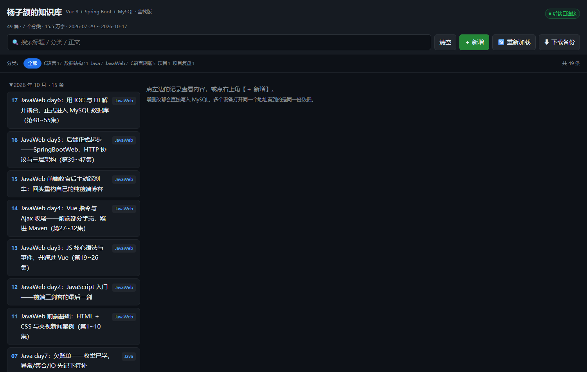
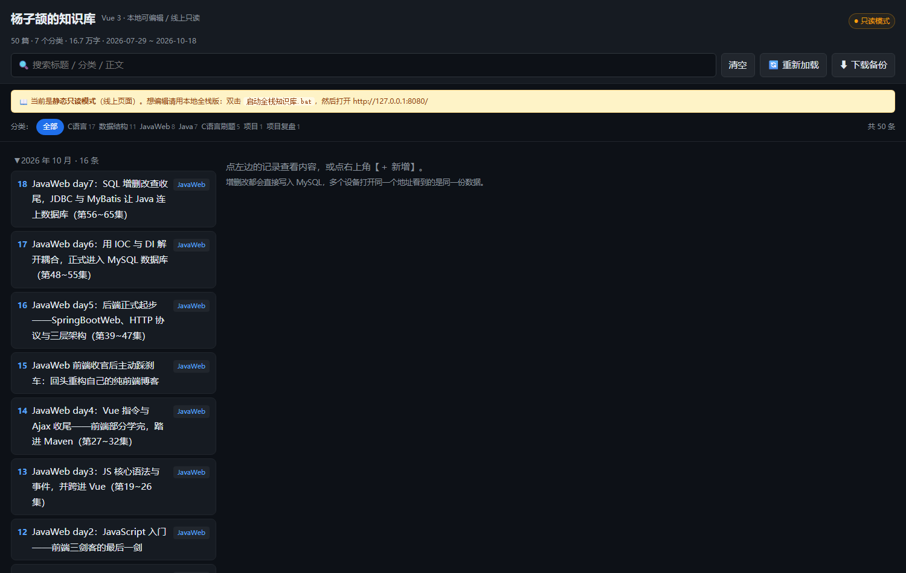

# 个人知识库 · 全栈版（Vue 3 + Spring Boot + MySQL）

> 从「静态 JSON 博客」升级成「真正的前后端分离知识库」：
> 前端 Vue 3 负责界面，后端 Spring Boot 提供 REST 接口，数据落在 MySQL。





---

## 一、怎么启动

### 前置条件

| 依赖 | 要求 | 本机现状 |
|---|---|---|
| JDK | 17+（用 25 编译、产出 17 字节码） | 便携版 `..\Java\jdk-25` |
| Maven | 3.6+ | 便携版 `..\Java\apache-maven-3.9.16` |
| MySQL | 8.x | 本机服务 `MySQL84`，`127.0.0.1:3306`，`root/123456` |

### 一键启动

双击本目录下的 **`启动全栈知识库.bat`**，它会：

1. 自动找到便携 JDK（找不到就用系统 `JAVA_HOME`）
2. 第一次运行先 `mvn package` 构建后端（之后有 jar 就跳过）
3. 启动 Spring Boot，自动打开 <http://127.0.0.1:8080/>

> 库和表都是自动创建的：`knowledge_base` 库由 JDBC 参数 `createDatabaseIfNotExist=true` 建，
> 表由 `schema.sql` 建，第一次启动还会把 `seed/notes.json` 里的 59 篇笔记自动导入。
> **所以换台电脑只要有 MySQL，双击就能用，不用手动建库导数据。**

### 手动方式

```bat
cd server
mvn spring-boot:run
:: 或者
mvn -DskipTests package && java -jar target\kb-server.jar
```

---

## 二、项目结构

```
JavaBlog/
├── 启动全栈知识库.bat          ← 一键启动（全栈版）
├── 发布到GitHub.bat            ← 本地编辑完，一键同步到 Pages
├── docs/preview-fullstack.png  ← 页面预览图
├── 启动知识库.bat              ← 旧静态版的启动脚本（仍可用）
├── src/main/webapp/            ← 静态站源码（Maven Web 目录，Pages 直接发布这个）
│   ├── index.html              ← 前端入口（Vue 3，无构建，原生 ES 模块）
│   ├── css/style.css
│   ├── js/
│   │   ├── api.js              ← 数据来源层：自动识别「后端模式 / 静态只读模式」
│   │   ├── app.js              ← Vue 应用
│   │   ├── data.js             ← 纯函数：筛选/排序/分组/统计
│   │   ├── dates.js  utils.js  storage.js
│   │   ├── main.js             ← 挂载入口
│   │   └── vendor/             ← vue / marked（本地文件，不联网）
│   └── data/notes.json         ← 静态站数据（也是后端种子数据的来源）
├── tests/frontend/             ← 前端 node 单元测试（109 个断言，不发布到 Pages）
├── docs/                       ← 预览图 + Vue 重构说明
├── tools/publish-to-pages.ps1  ← 【同步脚本】导出 + 比对 + commit + push
└── server/                     ← 后端（Spring Boot 3.5.6）
    ├── pom.xml
    └── src/main/
        ├── java/com/yangzijie/kb/
        │   ├── KbApplication.java        ← 启动类（@SpringBootApplication）
        │   ├── config/WebConfig.java     ← 静态资源托管 + CORS
        │   ├── domain/                   ← Note / CategoryStat / Stats
        │   ├── dao/                      ← NoteDao 接口 + JdbcNoteDao 实现
        │   ├── service/                  ← NoteService（业务）+ NoteSeeder（种子数据）
        │   └── web/                      ← NoteController + 全局异常处理
        └── resources/
            ├── application.yml           ← 数据源/端口/前端目录配置
            ├── schema.sql                ← 建表脚本
            └── seed/notes.json           ← 首次启动自动导入的 59 篇笔记
```

---

## 三、接口一览（REST）

| 方法 | 路径 | 说明 | 成功状态码 |
|---|---|---|---|
| GET | `/api/health` | 健康检查 | 200 |
| GET | `/api/notes?keyword=&category=` | 列表（关键词+分类可叠加） | 200 |
| GET | `/api/notes/{id}` | 单篇详情 | 200 / 404 |
| POST | `/api/notes` | 新增 | 201 |
| PUT | `/api/notes/{id}` | 修改 | 200 |
| DELETE | `/api/notes/{id}` | 删除 | 204 |
| GET | `/api/categories` | 分类 + 每类数量 | 200 |
| GET | `/api/stats` | 总数/分类数/字数/时间跨度 | 200 |

错误统一返回：`{"status": 400, "error": "标题不能为空"}`

### 用 curl 试一下

```bat
curl http://127.0.0.1:8080/api/health
curl http://127.0.0.1:8080/api/stats
curl "http://127.0.0.1:8080/api/notes?keyword=MySQL&category=JavaWeb"
curl -X POST http://127.0.0.1:8080/api/notes -H "Content-Type: application/json" ^
     -d "{\"title\":\"测试\",\"category\":\"测试\",\"content\":\"正文\"}"
```

---

## 四、前端改了什么（对照静态版）

| 位置 | 静态版 | 全栈版 |
|---|---|---|
| 取数据 | `fetch('src/main/webapp/data/notes.json')` | `GET /api/notes`（`js/api.js`） |
| 新增 | 本地 push + 手动保存文件 | `POST /api/notes`，落库成功才更新界面 |
| 修改 | 本地改 + 保存文件 | `PUT /api/notes/{id}` |
| 删除 | 本地 filter | `DELETE /api/notes/{id}` |
| 分类 | 前端 `collectCats` 算 | 后端 `GROUP BY category` 返回数量 |
| 统计 | 无 | `GET /api/stats`（篇数/分类/字数/时间跨度） |
| 保存到文件 | File System Access API | 改成「从后端重新加载」；另保留「下载备份」 |
| 离线 | 只能读本地缓存 | 后端挂了仍可读 localStorage 缓存 |

**界面渲染、筛选、分组、Markdown 渲染、搜索高亮一行都没改** —— 这就是前端分层的好处。

### 同一个前端，两种运行模式

前端代码只有一份，但会跑在两个环境里，靠 `js/api.js` 的 `detectMode()` 自动识别：

| 环境 | 探测结果 | 行为 |
|---|---|---|
| 本地 `http://127.0.0.1:8080` | 有后端 → `api` 模式 | 走 `/api/*`，可增删改，写进 MySQL，显示「● 后端已连接」 |
| GitHub Pages / 静态预览 | 无后端 → `static` 模式 | 读 `data/notes.json`，**只读**，显示「● 只读模式」+ 黄色横幅，编辑按钮自动隐藏 |

探测方式：启动时 `GET /api/health`，1.5 秒超时。通不了就降级——**页面照样能看，只是不能编辑**，
而不是弹一堆"连接失败"。

---

## 五、这个项目用到了你学过的哪些知识点

| 知识点 | 在项目里的位置 |
|---|---|
| Maven 坐标 / 父工程 / 依赖范围 | `server/pom.xml` |
| Spring Boot 起步依赖 / 自动配置 | `pom.xml` + `application.yml` |
| @ComponentScan 扫描范围 | `KbApplication` 所在包 `com.yangzijie.kb` |
| IOC / DI（构造器注入） | `NoteController`、`NoteService`、`JdbcNoteDao` 的构造器 |
| 分层解耦（Controller-Service-DAO） | `web/` → `service/` → `dao/` |
| 面向接口编程 | `NoteDao` 接口 + `JdbcNoteDao` 实现（测试里换成 FakeNoteDao） |
| JDBC / PreparedStatement / 连接池 | `JdbcNoteDao` + HikariCP |
| SQL（DDL / DML / 分组 / 聚合 / LIKE） | `schema.sql`、`JdbcNoteDao` 里各条 SQL |
| RESTful + HTTP 方法/状态码 | `NoteController`（201 / 204 / 400 / 404） |
| 全局异常处理 | `ApiExceptionHandler`（@RestControllerAdvice） |
| 静态资源映射 / 前后端同源 | `WebConfig.addResourceHandlers` |
| CORS 跨域 | `WebConfig.addCorsMappings` |
| Jackson（对象 ↔ JSON） | 所有 Controller 返回值自动序列化 |
| Vue 3 响应式 / computed | `src/main/webapp/js/app.js` |
| Ajax / fetch | `src/main/webapp/js/api.js` |
| ES 模块 + 无构建前端 | `index.html` + `js/main.js` |
| 单元测试（JUnit / node 断言） | `server/src/test`、`tests/frontend` |

---

## 六、测试

```bat
:: 后端：8 个单元测试（不连数据库，用内存版 DAO）
cd server
mvn test

:: 前端：109 个断言（node 直接跑，不需要浏览器）
cd tests\frontend
node data.test.mjs
node app.test.mjs
```

> 后端测试还抓到过一个真 bug：同一毫秒内连续新增，`System.currentTimeMillis()`
> 生成的 id 会重复。现在改成 `max(当前毫秒, 上一条 id + 1)` 的 CAS 自增。

---

## 七、后续可以加的东西（留给你练手）

1. **MyBatis / MyBatis-Plus**：把 `JdbcNoteDao` 换成 Mapper 接口，体会 ORM。
2. **分页**：`LIMIT ? OFFSET ?` + 前端的「上一页/下一页」。
3. **全文搜索**：MySQL `FULLTEXT ... WITH PARSER ngram`，比 `LIKE %关键词%` 快。
4. **标签（tag）**：多对多表 `tag` + `note_tag`，练习关联查询。
5. **登录鉴权**：Spring Security + JWT，让写操作只有自己能做。
6. **部署**：把 Vue 打包进 `server/src/main/resources/static`，打成一个 jar 丢到服务器。

---

## 八、发布到 GitHub Pages（C 方案：本地编辑 + 静态同步）

GitHub Pages 只能托管静态文件，跑不了 Java 和 MySQL。所以线上保持**只读静态站**，
编辑在本地全栈版里做，做完一键把数据同步上去。

### 日常流程

```
双击 启动全栈知识库.bat          → 本地全栈版（http://127.0.0.1:8080/）
   ↓  在页面上新增/编辑/删除笔记（真正写进 MySQL）
双击 发布到GitHub.bat            → 导出 → 比对 → 写回 src/main/webapp/data/notes.json → commit → push
   ↓  等 1~2 分钟
https://castoricelover777.github.io/blog/   ← 线上自动更新
```

### 脚本做了什么（`tools/publish-to-pages.ps1`）

1. 调 `GET /api/export`，拿到全部笔记（只有 id/date/created/title/category/content 六个字段）
2. 和现有 `src/main/webapp/data/notes.json` 做**语义比较**（按 id 排序后比内容，顺序不同不算变化）
3. 有变化才写文件（UTF-8 无 BOM、2 空格缩进，和原文件格式一致）
4. `git add src/main/webapp/data/notes.json` → `commit` → `push`

### 参数

| 参数 | 作用 |
|---|---|
| `发布到GitHub.bat -DryRun` | 只检测有没有变化，不写文件、不提交、不推送 |
| `发布到GitHub.bat -NoPush` | 写文件并本地提交，但不推送（预演/离线时用） |

> ⚠ 第一次同步时，因为数据库导出的顺序（日期倒序）和旧文件的手工顺序略有差异，
> 会看到一次「顺序重排」的大 diff（内容没变）。之后每次同步就只剩真正改动的几行了。

### 为什么不用 GitHub Actions 自动做

那样要么把数据库账号密码塞进仓库（危险），要么让 Actions 连你家里的 MySQL（不现实）。
个人知识库用「本地一键推送」最省事，也最安全。

---
*最后更新：2026-10-19*（新增 C 方案发布流程）
